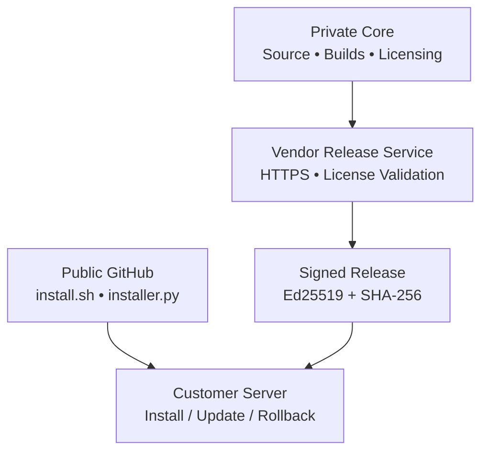

<p align="center">
  
  <h1 align="center">HelixPanel Pro</h1>
</p>

<p align="center">
  <a href="#-نصب-سریع"></a>
  <a href="#-امنیت-و-حفاظت-از-سورس"></a>
  
  <a href="#-وضعیت-انتشار"></a>
</p>

<p align="center" dir="rtl"><strong>یک تجربه یکپارچه برای نصب، مدیریت و به‌روزرسانی HelixPanel</strong></p>
<p align="center" dir="rtl"><a href="#-نصب-سریع">نصب سریع</a> · <a href="#-پیشنیازها">پیش‌نیازها</a> · <a href="#-مدیریت-و-بروزرسانی">مدیریت پنل</a> · <a href="#-امنیت-و-حفاظت-از-سورس">امنیت</a></p>

---

## 👁️ پیش‌نمایش آنلاین پنل — بدون نصب

**قبل از خرید، فعال‌سازی لایسنس یا نصب روی سرور، پنل را به‌صورت تعاملی ببینید.**

<div align="center">

[](https://hazhanhasani.github.io/HelixPanel-pro/)

**[ورود به وب‌سایت پیش‌نمایش](https://hazhanhasani.github.io/HelixPanel-pro/)** · **[نمایش مستقیم داشبورد](https://hazhanhasani.github.io/HelixPanel-pro/demo.html)**

</div>

داشبورد پیش‌نمایش شامل نمای کلی، نودها، کاربران، پلن‌ها، لایسنس، رویدادها و تنظیمات روشن/تاریک است. امکان جست‌وجو و افزودن کاربران **صرفاً آزمایشی** وجود دارد. هیچ اتصال واقعی به VPN، دیتابیس مشتری یا API مدیریتی برقرار نمی‌شود و داده‌ها با بازآوری صفحه به حالت اولیه برمی‌گردند.

> [!NOTE]
> این یک **نمونه تعاملی UI** است و نشان‌دهنده آماده‌بودن همه قابلیت‌های VPN، Node Engine و لایسنس تجاری در نسخه عملیاتی نیست. فایل‌های Pages فقط شامل HTML/CSS/JavaScript عمومی‌اند و هیچ سورس اصلی یا رمز محرمانه‌ای در آن‌ها وجود ندارد.

---

## 🎨 هویت بصری رسمی

نشان HelixPanel با فرم هندسی **H**، گره‌های شبکه و مسیر مارپیچی، در همه رابط‌های کاربری و دموی عمومی استفاده می‌شود. [مشاهده نشان اصلی](assets/logo-mark.webp).

## ✨ معرفی HelixPanel Pro

**هلیکس پنل پرو** در حال توسعه به‌عنوان یک پلتفرم تجاری برای مدیریت سرویس‌ها و زیرساخت چندسروری است. این مخزن، محل انتشار **نصب‌کننده عمومی، راهنمای راه‌اندازی و ابزارهای بررسی امنیتی** است؛ سورس اختصاصی پنل در GitHub عمومی منتشر نمی‌شود.

> [!IMPORTANT]
> **وضعیت فعلی: نسخه توسعه‌دهندگان (Developer Preview).**
> نصب‌کننده تک‌دستوری منتشر شده، اما تا زمانی که سرویس رسمی توزیع نسخه، کلیدهای عمومی امضا و فایل اجرایی تأییدشده فعال نشوند، نصب عملیاتی انجام نمی‌شود. نصب‌کننده به‌جای دانلود نسخه جعلی یا فاقد امضا، پیام واضح نمایش می‌دهد.

### 🌟 قابلیت‌های طراحی‌شده برای محصول

| حوزه | امکانات هدف |
|:---|:---|
| 🛰️ زیرساخت | معماری چندنودی، مدیریت سرورها و پایش سلامت |
| 👥 مشترکین | سهمیه حجم و زمان، طرح‌ها و مدیریت وضعیت اشتراک |
| 🛍️ تجاری | نمایندگی، فروش و اتصال به سرویس‌های خارجی |
| 🔐 لایسنس | مجوز اختصاصی امضاشده، محدودیت کاربر و نود |
| 🔄 انتشار | نصب یک‌دستوری، کنترل اصالت نسخه و بازگشت از نصب ناموفق |
| 🧰 توسعه‌پذیری | API و طراحی ماژولار برای افزودن موتورهای شبکه |

این جدول **چشم‌انداز محصول** است؛ به‌معنی آماده‌بودن همه قابلیت‌ها در نسخه فعلی نیست.

## 💳 خرید و تمدید آنلاین لایسنس (به‌زودی)

ساختار خرید از طریق ربات تلگرام و فعال‌سازی خودکار روی دامنه مستر توسعه یافته است. هر پرداخت فقط بعد از **استعلام تأییدشده از درگاه و تطبیق مبلغ** به صدور لایسنس می‌رسد؛ امضای Ed25519 و شناسه نصب نیز روی پنل مقصد بررسی می‌شوند.

**[📖 نحوه خرید و فعال‌سازی خودکار لایسنس](docs/BUY_LICENSE.fa.md)**

> درگاه زنده، کلید امضای رسمی، قیمت‌های واقعی و آیدی ربات هنوز باید پیکربندی و تست شوند؛ این بخش در حال حاضر گزینه پرداخت عملیاتی نیست.

---

## 🎁 پلن رایگان دائمی Community

اولین نصب HelixPanel، **بدون خرید، صدور دستی یا واردکردن لایسنس** در حالت رایگان آغاز می‌شود:

| ویژگی | نسخه رایگان | نسخه تجاری |
|---|---|---|
| تعداد نود | **۱ نود** | بر اساس لایسنس خریداری‌شده |
| تعداد کاربران | **۲۵ کاربر** | بر اساس لایسنس خریداری‌شده |
| مدت اعتبار | **بدون انقضا** | طبق قرارداد و لایسنس |
| نصب روی VPS | بدون کد فعال‌سازی | کد یک‌بارمصرف `HP-...` |
| نصب روی cPanel/DirectAdmin | ویزارد PHP رایگان | ارتقای لایسنس پس از نصب |

**توجه:** دسترسی به نسخه رایگان نباید نیازمند فعال‌سازی پولی باشد، ولی نصب VPS همچنان به وجود باینری **امضاشده** و سرویس انتشار رسمی نیاز دارد. `config.public.json` فعلاً در حالت `preview` است و دانلود اجرایی عمومی هنوز فعال نیست. نصب مستر PHP با MySQL مستقل از آن سرویس طراحی شده است.

### 🚀 نصب سریع مستر روی هاست

فقط بسته نصب را از [GitHub Actions](https://github.com/hazhanhasani/HelixPanel-pro/actions/workflows/hosting-master-package.yml) دریافت و فایل‌های `upload-to-public_html` را در دامنه دارای HTTPS قرار بده. سپس:

```text
https://your-domain.example/setup.php
```

فرم فارسی، ایجاد جداول MySQL، ذخیره امن تنظیمات و فعال‌سازی رایگان را انجام می‌دهد. برای تایید مالکیت، رمز اولیه را از فایل `setup.key` خارج از `public_html` دریافت کن.

**[راهنمای گام‌به‌گام نصب روی cPanel و DirectAdmin](hosting-master/README.fa.md)**

---

## ⚡ نصب سریع

**فقط یک دستور در ترمینال سرور لینوکسی اجرا کن:**


```bash
curl -fsSL https://raw.githubusercontent.com/hazhanhasani/HelixPanel-pro/main/install.sh | sudo bash
```


نصب‌کننده به‌صورت تعاملی کار می‌کند: پیش‌نیازها را بررسی می‌کند، شناسه نصب ثابت می‌سازد، وضعیت سرور رسمی انتشار را می‌سنجد و **پس از دریافت لایسنس معتبر** نسخه امضاشده را نصب می‌کند.

**برای امنیت بیشتر، پیش از اجرای اسکریپت با دسترسی مدیر، محتوای آن را بررسی کن:** [مشاهده سورس عمومی install.sh](install.sh).

<details>
<summary><b>🔎 روش نصب با بررسی دستی اسکریپت</b></summary>


```bash
curl -fsSLo install.sh https://raw.githubusercontent.com/hazhanhasani/HelixPanel-pro/main/install.sh
less install.sh
sudo bash install.sh
```


</details>

### 🧩 پیشنیازها

| مورد | توضیح |
|:---|:---|
| سیستم‌عامل | سرور لینوکسی با systemd، ترجیحاً Ubuntu 22.04+ یا Debian 12+ |
| معماری پردازنده | `x86_64` یا `arm64` |
| دسترسی | `root` یا `sudo` |
| ابزارها | Python 3.10+، OpenSSL، curl، useradd (در سیستم‌های سازگار برخی پیش‌نیازها خودکار نصب می‌شوند) |
| ارتباط شبکه | دسترسی HTTPS به GitHub و سرور رسمی انتشار |
| مجوز | لایسنس معتبر صادرشده برای شناسه نصب همان سرور |

در حالت انتشار آزمایشی، حتی اگر پیش‌نیازها کامل باشند، نبود فایل اجرایی امضاشده مانع نصب خواهد شد.

## 🖥️ مستر فقط مدیریتی — روی هاست یا VPS

مستر HelixPanel هیچ ترافیک کاربران VPN را عبور نمی‌دهد. **تمام ترافیک کاربران مستقیماً به نودها می‌رود** و نود از طریق کانال HTTPS خروجی، اطلاعات وضعیت را به مستر ارسال می‌کند.

| نسخه مستر | محل نصب | ذخیره‌سازی | اتصال نود |
|---|---|---|---|
| **Standalone PHP Master** | cPanel / DirectAdmin | MySQL خود هاست | `node.php` و Node Agent |
| **Go Master** | VPS / سرور اختصاصی | Prototype JSON (در آینده PostgreSQL) | همان API و Node Agent |

هر مشتری، نودهای خودش را ثبت و با توکن یک‌بارمصرف ۱۵ دقیقه‌ای جفت می‌کند. ثبت اولیه فقط یک بار انجام می‌شود؛ Heartbeat نود هر ۳۰ ثانیه ارسال می‌شود و نود غیرفعال بعد از ۹۰ ثانیه در پنل آفلاین نشان داده می‌شود.

**فناوری مدیریتِ پروکسی هنوز جدا از Node Agent آزمایشی است**؛ یعنی نصب فعلی، خودکار سرویس Xray/Sing-box یا مصرف واقعی اشتراک تولید نمی‌کند. این‌ها در نسخه بعدی با Engine Adapter پیاده‌سازی خواهند شد.

**[📘 آموزش نصب مستقل Master روی cPanel و DirectAdmin](hosting-master/README.fa.md)** · **[📘 آموزش اتصال Node به هر دو نوع مستر](docs/NODE_SETUP.fa.md)**

---
## 🔄 فعال‌سازی لایسنس و آپدیت کاملاً خودکار

در **اولین نصب** فقط یک کد اختصاصی `HP-...` که پس از خرید صادر می‌شود وارد می‌کنی. پنل شناسه سرور را ایجاد کرده و از سرویس فروشنده یک **لایسنس دیجیتال امضاشده** دریافت می‌کند؛ نیازی به تولید دستی فایل لایسنس برای خریدار نیست.

بعد از نصب موفق:

- 🔐 کد فعال‌سازی فقط روی همان سرور معتبر است و در `/etc/helixpanel/activation.key` با مجوز Root-only ذخیره می‌شود.
- 🔁 `helixpanel-update.timer` با فاصله حدود **۶ ساعت** و تأخیر تصادفی اجرا می‌شود.
- ✅ اعتبار لایسنس دوباره از سرویس فروشنده دریافت و نسخه جدید در صورت انتشار دانلود می‌شود.
- 🛡️ امضای Ed25519 و SHA-256 بررسی می‌شود؛ نسخه نامعتبر نصب نخواهد شد.
- 🧯 پس از شکست Health Check، نصب‌کننده تلاش می‌کند نسخه قبلی را برگرداند.
- 💳 تمدید **دوره خرید** خودکار و رایگان نیست؛ لازم است فروشنده اعتبار سفارش را تمدید کند. سپس همان کد روی همان سرور اعتبار جدید را بدون دخالت کاربر دریافت می‌کند.

**وضعیت:** این قابلیت در کد نصب‌کننده و سرویس لایسنس توسعه یافته است، اما برای استفاده واقعی باید دامنه HTTPS، سرویس فروشنده، کلیدهای عمومی و یک فایل اجرایی امضاشده راه‌اندازی شوند. `config.public.json` تا آن زمان در حالت `preview` می‌ماند.

برای بررسی زمان اجرای آپدیت و خطاها:

```bash
sudo systemctl list-timers helixpanel-update.timer
sudo systemctl status helixpanel-update.timer
sudo journalctl -u helixpanel-update.service -n 80 --no-pager
```

آپدیت دستی همچنان وجود دارد، اما بعد از راه‌اندازی موفق سیستم نیازی به اجرای مرتب آن نیست.

## 🛠️ مدیریت و بروزرسانی

**بررسی وضعیت نصب و سرویس:**


```bash
curl -fsSL https://raw.githubusercontent.com/hazhanhasani/HelixPanel-pro/main/install.sh | sudo bash -s -- status
```


**دریافت شناسه نصب برای صدور لایسنس:**


```bash
curl -fsSL https://raw.githubusercontent.com/hazhanhasani/HelixPanel-pro/main/install.sh | sudo bash -s -- identity
```


**به‌روزرسانی از کانال رسمی با حفظ لایسنس نصب‌شده:**


```bash
curl -fsSL https://raw.githubusercontent.com/hazhanhasani/HelixPanel-pro/main/install.sh | sudo bash -s -- update
```


پس از نصب واقعی، سرویس تحت `systemd` اجرا می‌شود. دستورات کاربردی:


```bash
sudo systemctl status helixpanel
sudo journalctl -u helixpanel -n 100 --no-pager
sudo systemctl restart helixpanel
```


## 🏗️ ساختار توزیع



- **ریپازیتوری خصوصی:** سورس اصلی، منطق تجاری و ابزارهای صدور و امضای نسخه فقط برای تیم توسعه.
- **ریپازیتوری عمومی (همین مخزن):** اسکریپت‌های نصب، مستندات، تست‌ها و کلیدهای *عمومی* اعتبارسنجی.
- **سرور توزیع فروشنده:** تحویل فایل اجرایی کامپایل‌شده تنها پس از بررسی لایسنس و ایجاد لینک دانلود موقت.

## 🛡️ امنیت و حفاظت از سورس

| کنترل امنیتی | نحوه کار |
|:---|:---|
| مجوز دیجیتال | بررسی لایسنس امضاشده با Ed25519 |
| اصالت نسخه | تأیید امضای مانیفست انتشار |
| یکپارچگی فایل | تطبیق SHA-256 باینری دانلودشده |
| اتصال امن | دانلود فقط از HTTPS و میزبان مجاز |
| پایداری آپدیت | تعویض نسخه و تلاش برای Rollback در صورت شکست Health Check |
| جداسازی سورس | عدم انتشار کد اصلی پنل یا کلیدهای خصوصی در مخزن عمومی |

> [!CAUTION]
> عمومی‌بودن نصب‌کننده به معنی عمومی‌بودن سورس پنل نیست؛ بااین‌حال هیچ نرم‌افزار نصب‌شده روی سرور مشتری را نمی‌توان کاملاً غیرقابل مهندسی معکوس دانست. برای گزارش آسیب‌پذیری، از [راهنمای امنیت](SECURITY.md) استفاده کن و هرگز لایسنس یا کلید خصوصی را در Issues منتشر نکن.

## 📂 فایل‌های مهم

| فایل | کاربرد |
|:---|:---|
| [`install.sh`](install.sh) | نصب و آپدیت تک‌دستوری با راهنمای تعاملی |
| [`installer.py`](installer.py) | بررسی امضا، دریافت نسخه و مدیریت سرویس |
| [`config.public.json`](config.public.json) | وضعیت انتشار و کلیدهای عمومی مورد اعتماد؛ فعلاً Preview |
| [`tests/`](tests/) | تست امنیتی نصب‌کننده |
| [`SECURITY.md`](SECURITY.md) | سیاست گزارش مسائل امنیتی |
| [`LICENSE`](LICENSE) | مجوز اجزای منتشرشده در این مخزن |

## ❓ پرسش‌های متداول

<details>
<summary><b>آیا کاربران می‌توانند سورس اصلی را ببینند؟</b></summary>

خیر، سورس اختصاصی پنل داخل این ریپازیتوری وجود ندارد. کاربران می‌توانند کد عمومی نصب‌کننده را مشاهده یا Fork کنند و فایل اجرایی نصب‌شده نیز از نظر فنی قابل تحلیل است.

</details>

<details>
<summary><b>آیا نصب نیاز به GitHub Token دارد؟</b></summary>

خیر؛ نصب‌کننده از فایل‌های عمومی GitHub استفاده می‌کند و برای دریافت باینری، به سرویس توزیع دارای لایسنس متصل می‌شود.

</details>

<details>
<summary><b>چرا فعلاً نصب کامل نمی‌شود؟</b></summary>

چون سرور رسمی صدور/توزیع نسخه و کلیدهای انتشار هنوز برای استفاده مشتری فعال نشده‌اند. عمداً اجازه نصب فایل فاقد امضای معتبر داده نمی‌شود.

</details>

<details>
<summary><b>پنل بعد از نصب از اینترنت باز می‌شود؟</b></summary>

سرویس در حالت پیش‌فرض روی `127.0.0.1:8080` اجرا می‌شود. برای دسترسی عمومی باید Reverse Proxy با HTTPS و کنترل دسترسی مناسب تنظیم شود.

</details>

## 🤝 مشارکت و پشتیبانی

پیشنهادها و گزارش خطاهای **نصب‌کننده عمومی** را می‌توان از طریق [Issues](https://github.com/hazhanhasani/HelixPanel-pro/issues) ثبت کرد. این مخزن محل انتشار سورس تجاری نیست.

---

**HelixPanel Pro** · Secure delivery. Private core. Professional operations.

© 2026 HelixPanel · [Public Installer License](LICENSE)


